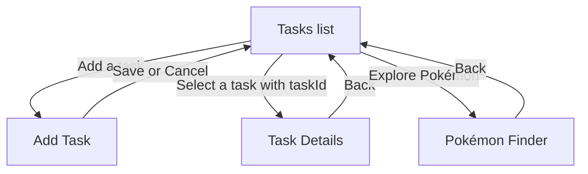

# Week 3 workshop preparation

## App shell plan

| Page name | Layout choice | Key controls | Navigates to |
| --- | --- | --- | --- |
| Tasks (main) | `Grid` with heading, action row, and a `CollectionView` | Add task button, task cards, due date and status | Add Task; selecting a task opens Task Details |
| Add Task | `ScrollView` with `VerticalStackLayout` | Name `Entry`, description `Editor`, `DatePicker`, Save and Cancel | Save or Cancel returns to Tasks |
| Task Details | `VerticalStackLayout` with a small `Grid` for due date | Title, description, status, completion button, Back | Back returns to Tasks |
| Pokémon Finder | `Grid` with a search row and a `CollectionView` | Search `Entry`, Search button, result cards, error message | Opened from Tasks; Shell Back returns to Tasks |



## Sample project checklist

The two downloaded `maui-samples-main` zip files have the same SHA-256 hash, so one copy is enough. The notes below come from `10.0/Beginners-Series/BeginnersTask` in the zip; it was inspected in place without unpacking the full repository.

- `Platforms/` — Contains platform-specific startup code, manifests, and settings for Android, iOS, Mac Catalyst, Windows, and Tizen.
- `Resources/` — Holds shared app assets such as images, fonts, icons, splash art, and styles that MAUI packages for each target.
- `MauiProgram.cs` — Creates the MAUI app, registers `App`, configures fonts and services, and builds the dependency injection container.
- `App.xaml` and `App.xaml.cs` — Define shared application resources; the code-behind initializes them and opens the app shell in a window.
- `AppShell.xaml` and `AppShell.xaml.cs` — Declare the root `MainPage` route; the code-behind registers `DetailPage` as a navigation route.
- `TargetFrameworks` in `BeginnersTask.csproj` — Targets .NET 10 for Android, iOS, and Mac Catalyst, with Windows added conditionally; platform target frameworks control which builds are available.

## Build and development notes

From this folder, the workshop run command is:

```sh
~/.dotnet/dotnet build -t:Run -f net10.0-android
```

Tasks are stored as JSON in the app's private data folder and loaded on startup. Adding a task or changing its completion status writes the updated collection to disk. Detail navigation passes a `taskId` query parameter; `DetailPage` reads it with `QueryProperty` and looks up the selected task. The starter `.gitignore` excludes `bin/` and `obj/` build output.

## Week 4 API activity

The Pokémon Finder uses PokéAPI's `pokemon/{name-or-id}` endpoint. `Pokemon` and its nested type models map the JSON response. `PokemonService` calls `GetFromJsonAsync<Pokemon>()` through a typed `HttpClient`, registered in `MauiProgram.cs` with the API base address. The page displays results in an `ObservableCollection<Pokemon>` bound to a `CollectionView`, and reports not-found and connection errors. The Android manifest includes internet access permission. Search with a name such as `pikachu` or a Pokédex number such as `25`.

The system `dotnet` command resolves to an SDK without MAUI workloads. The user-local SDK at `~/.dotnet/dotnet` already has the Android MAUI workload. The command above built successfully and launched package `com.companyname.myapp` on the `Pixel_6` emulator.
