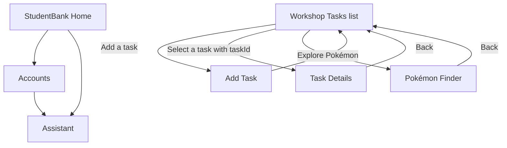

# StudentBank mobile app

The MAUI project is a coursework prototype with sign-in, server-backed StudentBank demo accounts, internal demo transfers, a TrueLayer sandbox read-only connection, transaction insights with per-request consent, market quote lookup, and AI explanations. StudentBank transfers move only fictional balances in the local SQLite database. TrueLayer is configured for sandbox account information, and does not support payment initiation here.

## Configure providers on macOS

Keep provider credentials on the backend; never add them to the MAUI app or commit them. Set the following environment variables in the terminal that starts the backend:

```sh
export OPENAI_API_KEY="your-server-side-key"
export TRUELAYER_CLIENT_ID="your-TrueLayer-sandbox-client-id"
export TRUELAYER_CLIENT_SECRET="your-TrueLayer-sandbox-client-secret"
export TRUELAYER_REDIRECT_URI="https://console.truelayer.com/redirect-page"
export ALPHA_VANTAGE_API_KEY="your-market-data-key"
```

Create a TrueLayer sandbox application and configure the same redirect URI in its dashboard. The app opens the provider consent page; for this prototype, copy the returned authorization code from the redirect page and paste it into Accounts. The server validates the OAuth state and exchanges the code. The sandbox access token is held in server memory, so reconnect after a server restart or token expiry. Disconnect removes the in-memory token.

The external bank connection requests read-only account, balance, and transaction scopes. It is not production bank access and does not send payments. The user must explicitly approve the provider consent screen. Production Open Banking access requires an eligible regulated/registered provider and provider approval. Do not ask users to give StudentBank their bank password.

Alpha Vantage provides market quote data for the Markets screen; available timing and request quotas depend on the account entitlement. Quotes may be delayed. No orders are placed. The AI market explanation is educational and does not provide investment advice.

The Assistant tab's general chat sends only the typed question to the OpenAI Responses API. Transaction insights are separate: the user must check the consent box for each request. The server sends only aggregated outgoing totals and transaction counts by category and currency for the previous 30 days; merchant names and account identifiers are excluded. Replies are educational, can be wrong, and are not financial advice.

For the Android emulator, start the backend from the repository root so it listens on port 5080, after configuring the credentials above:

```sh
dotnet run --project WebApplication1 --urls http://0.0.0.0:5080
```

In a second terminal, start the Android app from `MyApp/`:

```sh
~/.dotnet/dotnet build -t:Run -f net10.0-android
```

The Android app uses cleartext HTTP to reach the local development server. This is for the emulator prototype; use HTTPS and authenticated, rate-limited infrastructure before any public deployment. Assistant requests are limited to 12 per minute and market quotes to 5 per minute per server policy.

## Week 3 shell and navigation

## App shell plan

| Page name | Layout choice | Key controls | Navigates to |
| --- | --- | --- | --- |
| StudentBank Home | `ScrollView`, `Grid`, `VerticalStackLayout`, and bindable transaction rows | Authenticated demo-ledger balance and recent activity, quick actions, Assistant shortcut | Accounts; Transfer; Assistant |
| Accounts | `ScrollView` with account cards and collection views | Authenticated demo accounts, create account, TrueLayer sandbox connection and recent external transactions | Home; Assistant through Shell tabs |
| Assistant | `Grid` with prompt chips, `CollectionView` conversation, message `Entry`, and explicit consent panel | General banking education; opt-in aggregate transaction insights; loading feedback | Home; Accounts through Shell tabs |
| Markets | `ScrollView` with quote card and explanation panel | Symbol search, external quote fields, educational AI explanation | Home; Assistant through Shell tabs |
| Tasks (workshop page) | `Grid` with heading, action row, and a `CollectionView` | Add task button, task cards, due date and status | Add Task; selecting a task opens Task Details |
| Add Task | `ScrollView` with `VerticalStackLayout` | Name `Entry`, description `Editor`, `DatePicker`, Save and Cancel | Save or Cancel returns to Tasks |
| Task Details | `VerticalStackLayout` with a small `Grid` for due date | Title, description, status, completion button, Back | Back returns to Tasks |
| Pokémon Finder | `Grid` with a search row and a `CollectionView` | Search `Entry`, Search button, result cards, error message | Workshop route retained for Week 4 practice |



## Sample project checklist

The two downloaded `maui-samples-main` zip files have the same SHA-256 hash, so one copy is enough. The notes below come from `10.0/Beginners-Series/BeginnersTask` in the zip; it was inspected in place without unpacking the full repository.

- `Platforms/` — Contains platform-specific startup code, manifests, and settings for Android, iOS, Mac Catalyst, Windows, and Tizen.
- `Resources/` — Holds shared app assets such as images, fonts, icons, splash art, and styles that MAUI packages for each target.
- `MauiProgram.cs` — Creates the MAUI app, registers `App`, configures fonts and services, and builds the dependency injection container.
- `App.xaml` and `App.xaml.cs` — Define shared application resources; the code-behind initializes them and opens the app shell in a window.
- `AppShell.xaml` and `AppShell.xaml.cs` — Declare the root `MainPage` route; the code-behind registers `DetailPage` as a navigation route.
- `TargetFrameworks` in `BeginnersTask.csproj` — Targets .NET 10 for Android, iOS, and Mac Catalyst, with Windows added conditionally; platform target frameworks control which builds are available.

## Workshop pages kept in the project

Tasks are stored as JSON in the app's private data folder and loaded on startup. Adding a task or changing its completion status writes the updated collection to disk. Detail navigation passes a `taskId` query parameter; `DetailPage` reads it with `QueryProperty` and looks up the selected task. The starter `.gitignore` excludes `bin/` and `obj/` build output.

## Week 4 API activity

The Pokémon Finder uses PokéAPI's `pokemon/{name-or-id}` endpoint. `Pokemon` and its nested type models map the JSON response. `PokemonService` calls `GetFromJsonAsync<Pokemon>()` through a typed `HttpClient`, registered in `MauiProgram.cs` with the API base address. The page displays results in an `ObservableCollection<Pokemon>` bound to a `CollectionView`, and reports not-found and connection errors. The Android manifest includes internet access permission. Search with a name such as `pikachu` or a Pokédex number such as `25`.

The page shows a progress indicator while searching, disables repeated searches, and gives the search field an accessibility description and hint. The PokéAPI page remains in the project as workshop practice, but Home is now the app's starting screen. The wider design-thinking worksheet for StudentBank and this app is in `docs/DESIGN_THINKING_WORKSHEET.md` at the repository root.

The system `dotnet` command may resolve to an SDK without MAUI workloads. The user-local SDK at `~/.dotnet/dotnet` has the Android MAUI workload.

## Week 6 proposal and feasibility work

See [`../docs/WEEK_6_PROPOSAL_CRITIQUE_PITCH.md`](../docs/WEEK_6_PROPOSAL_CRITIQUE_PITCH.md) for the proposal draft, architecture map, prioritized scope, critique and usability evidence templates, technical risk register, and Week 6–12 plan. The Android emulator run demonstrates the MAUI shell, but does not verify the mobile banking screens against the web banking database. The highest-priority open technical question is whether the MAUI client can securely read the signed-in user's accounts from the existing API. Record the result of that spike here when it has been run. Do not fill in interview or critique logs without actual participant feedback.

For a course-wide map of the materials shared so far, see [`../docs/COURSE_WEEK_ALIGNMENT.md`](../docs/COURSE_WEEK_ALIGNMENT.md). It places the Week 3 shell work and Week 4 API work here, and distinguishes the blank persona template from collected user evidence.
