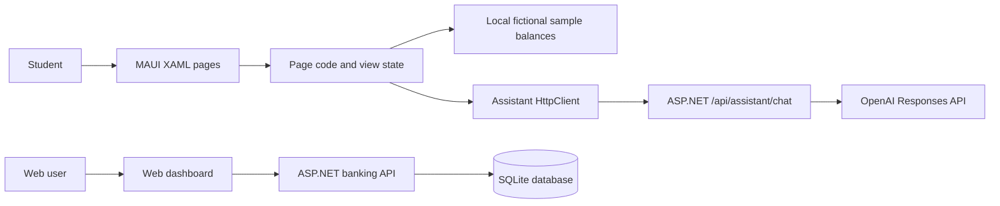

# Week 6 proposal, critique and pitch

This document turns the Week 6 slide guidance into a working proposal for the StudentBank coursework prototype. Requirements below are summarized from the slides; project status is based on the repository as it stands. Suggested user needs and feedback are clearly marked as unvalidated.

## Slide guidance summary

The Week 6 checkpoint asks for evidence of research and development, real-user requirements, prototypes and navigation, frontend/backend/data architecture, a prioritized feature list, a defined audience, technical risks with early tests, and a phased plan through Week 12. The session frames the work around usability, feasibility, scope, critique, and a three-minute pitch.

The slides recommend testing the riskiest assumption first, collecting and acting on peer critique, using MoSCoW to prioritize scope, and ending each phase with something runnable. Before the next checkpoint, the stated independent practice is to complete a feedback log, refine the feature list and architecture, plan the phases, and run a technical spike. This document is a draft; it does not claim that interviews, critique, or usability tests have happened.

## Proposal

### One-line concept

**StudentBank helps students understand their money by presenting account balances and recent activity clearly, with an assistant for general budgeting and banking questions.**

This is a proposal, not a finding from user research.

### Intended audience and context

- **Proposed users:** students who want a clear view of their accounts and everyday money questions answered.
- **Proposed context:** checking a phone between study, travel, and other daily activities, sometimes with one hand or unreliable connectivity.
- **Evidence status:** this audience and context are assumptions carried forward from the project brief and design worksheet. Confirm them through short interviews before treating them as requirements.

### Problem and primary task

**Provisional problem:** students may have difficulty understanding their available money when balances, currencies, recent activity, or the meaning of an assistant's answers are unclear.

**Primary task to validate:** open the app and understand the balance and recent activity for an account; optionally ask a general budgeting question and understand what the assistant can and cannot access.

### User stories to validate

- As a student, I want to see each account balance with its currency so I can understand how much money is in each account.
- As a student, I want to review recent activity so I can recognize what has changed.
- As a student, I want to ask a general budgeting question so I can learn how to plan everyday spending.
- As a student, I want clear feedback about whether information is sample or current, and whether it is saved locally or on the server, so I know what the app is showing me.

These stories are hypotheses until discussed with students. A useful acceptance criterion for the prototype is: *Given I open the Home screen, when the account summary appears, then I can identify the currency and whether the values are sample data without asking for help.* Validate the wording and task with participants.

## Current prototype and architecture

The repository contains an ASP.NET Core web banking demo and a .NET MAUI mobile prototype. They are not currently one connected banking product: the mobile app displays fictional local sample balances and activity, while the web app has its own authenticated SQLite banking flows. The mobile assistant sends the typed question to the server endpoint; it does not attach account data. Keep this boundary explicit in any pitch or demo.

The current mobile app has Home, Accounts, and Assistant tabs, plus retained Week 3 task pages and the Week 4 Pokémon API exercise. The backend has authenticated account and transaction endpoints. The mobile banking screens are not yet wired to those endpoints. See [mobile development notes](../MyApp/DEVELOPMENT_NOTES.md) and [design-thinking worksheet](DESIGN_THINKING_WORKSHEET.md) for implementation details.

## Prioritized scope (draft)

| Priority | Feature | Reason / boundary |
| --- | --- | --- |
| Must | Home and Accounts screens identify each fictional balance and currency clearly | Delivers the demo's core account-understanding task; label all displayed data as sample |
| Must | Show recent sample activity and clear loading, empty, and error states where a request occurs | Users need feedback and should not have to guess whether something worked |
| Must | Assistant explains general budgeting and banking concepts, with an explicit privacy boundary | Keep it educational; do not send account details or perform financial actions |
| Must | Three-tab navigation and accessible labels, scalable text, and large touch targets | Supports predictable use on a phone |
| Should | Connect mobile account views to the authenticated StudentBank API | Removes the current split between the mobile sample data and web banking data; requires a secure, tested client flow |
| Should | Provide a visible refresh or last-updated state and a useful offline message | Makes data freshness and connectivity understandable |
| Could | Cache account and activity reads for limited offline viewing | Only after defining freshness and sign-out behavior |
| Could | Add a simple spending summary based on clearly explained data | Requires validated user value and careful handling of financial data |
| Won't for this coursework phase | Real payments, production banking integration, investment advice, or AI actions on accounts | Outside safe, feasible prototype scope |
| Won't for this coursework phase | Social features and elaborate personalization | Defer until core needs and time allow |

Revisit these priorities after user conversations and critique. “Must” does not mean production-ready banking.

## Usability and critique plan

Run a small think-aloud session with student participants using the emulator or a clickable prototype. Ask participants to complete tasks rather than tour screens. Record completion, errors, time or steps, hesitation, and comments. Do not fill the evidence table with invented results.

1. Find the balance for a named account and say which currency it uses.
2. Find a recent transaction and explain whether it is sample data.
3. Ask the assistant a basic budgeting question, then explain what account information it can access.
4. Navigate back to Home and find Accounts using the app's navigation.

Use accessibility checks alongside the task: text scaling, contrast, screen-reader labels, keyboard focus where applicable, and whether primary actions are easy to reach on a phone. The first design question to test is whether people can tell sample information from live or saved information.

### Research and usability evidence log

Use the guide below with three student participants. Ask for permission to take notes, avoid collecting account or other sensitive personal information, and label notes P1, P2, and P3. The friends suggested for these sessions are not named in this public project document. Replace the blank fields only with what each person actually says or does.

#### Short interview and prototype session

**Opening:** “I’m working on a student banking app prototype. I’d like to learn how you understand the screens, not test you. There are no right answers. You can skip a question or stop at any time. May I take anonymous notes?”

Ask these questions before showing the app:

1. What do you usually want to check first when you open a banking app?
2. Tell me about the last time it was hard to understand a balance or transaction.
3. When you check money on your phone, where are you and what are you doing?
4. What would you expect a banking assistant to know about your account? What should it never do?

Then give the participant the phone and ask them to:

1. Find a balance and tell you its currency and whether they think it is sample or live data.
2. Find a recent transaction and explain what they think it means.
3. Ask the assistant a general budgeting question, then say what information they think it can access.
4. Return to Home and find the Accounts screen.

While they work, stay quiet. Record what they do, where they pause, any errors, and their words as accurately as possible. Afterward ask: “What was clear?”, “What was confusing?”, and “If you could change one thing, what would you change?” Do not suggest answers during the task.

| Participant code | Date | What they said about their needs (short notes or exact brief quotes) | Task result / hesitation observed | Change they suggested | Permission to use anonymous notes? |
| --- | --- | --- | --- | --- | --- |
| P1 |  |  |  |  |  |
| P2 |  |  |  |  |  |
| P3 |  |  |  |  |  |

The sessions have not been conducted yet. Do not describe the proposed questions or likely answers as participant feedback.

#### Desk-review answers and design notes (not student feedback)

These notes answer the interview topics only from the app files and screens. They describe the current prototype; they do not tell us what Ramesh, Shiva, Bibashu, or other students think.

| Topic | What the current prototype shows | Analysis / next step |
| --- | --- | --- |
| What can a user check first? | Home puts a £2,450.75 total balance first, followed by quick actions and recent activity. Accounts lists two GBP demo balances, £1,820.75 and £630.00; they add up to the total. | The screen hierarchy is clear in the code. Ask participants whether total balance or separate accounts is more useful to them. |
| Is the information sample or live? | Home says “Sample balance · Demo account”; Accounts says “A clear view of your sample balances” and explains the app is not connected to a bank. | Good prototype disclosure. However, Accounts also says “Updated just now” while the displayed value is static demo data. Remove that freshness claim or explain what it refers to. |
| Can a user understand recent activity? | Home shows four sample transactions with merchant, category/date, and amount. | The balance card identifies the screen as a demo, but mark the activity itself as sample too. Test whether participants understand that amounts are fictional. |
| What actions appear available? | Send, Add, and Cards buttons open a dialog explaining that no real money moves. | They look like real banking actions before the dialog appears. Consider labeling them as previews or replacing them with non-action examples until implemented; ask participants what they expect each button to do. |
| What does the assistant claim and receive? | The Assistant screen says it cannot access accounts or move money and warns users not to share secrets. The server request contains the typed question and does not attach account balances or identifiers. | The boundary is stated clearly in the interface and code. Verify through a participant task whether the wording is understood; also test the unconfigured-server and connection-error states. |
| Does the current code show real student context or usability? | No interviews, participant observations, task-completion results, or peer critique are present in the repository. | The app files cannot establish where students use banking apps, what they need first, or whether they find this prototype easy. Collect those answers directly and then update the blank P1–P3 forms. |

**Design-review summary:** the prototype communicates that balances are examples and that the assistant is not account-aware. The clearest fix from inspecting the current screens is to remove the misleading “Updated just now” wording and label recent activity as sample. Treat these as code-review recommendations, not user-validated changes.

### Peer critique log

Record feedback using “I like / I wish / What if,” name the design lens, then decide whether to accept, adapt, or reject it with a reason. No peer feedback has been supplied yet.

| Feedback | Lens | Decision | Rationale and next action |
| --- | --- | --- | --- |
| Not collected yet |  |  |  |

## Feasibility and early technical spike

### Known evidence

- The MAUI app has been shown running in an Android emulator, which supports the basic cross-platform UI and navigation feasibility.
- The repository contains an ASP.NET API, SQLite-backed web banking operations, and a separate assistant endpoint.
- The mobile assistant service targets the local development backend. A public release would need a secured HTTPS backend and operational controls.
- The mobile account screens currently use fictional sample data rather than the user's authenticated web account data.

### Riskiest assumption and spike

**Assumption:** the MAUI app can securely read the signed-in user's account summary and recent activity from the existing ASP.NET API without exposing credentials or account data to the assistant.

**Spike:** build one authenticated read-only request from the MAUI app to the existing account endpoint, render one account's currency and balance, handle sign-out and a failed connection, and verify that the assistant request still contains only the typed question. Timebox this before expanding the mobile feature set. The spike is not complete yet.

| Risk | Likelihood | Impact | Early check / mitigation |
| --- | --- | --- | --- |
| Mobile app and web banking data remain disconnected | High | High | Spike one authenticated read-only account request before promising mobile live data |
| API or AI service is unavailable, slow, or rate-limited | Medium | High | Show retry/error feedback; retain clearly labelled sample data for the demo; test timeout and no-key behavior |
| Assistant output is mistaken for personal financial advice or account-aware guidance | Medium | High | State its limits in the UI and response instructions; test prompts about account access, transfers, fraud, and advice |
| Sensitive account data or API credentials leak to the app or repository | Medium | High | Keep provider keys server-side; minimize mobile data; inspect logs and requests; never commit secrets |
| Scope exceeds the remaining schedule | High | Medium | Keep the Must list small and defer Should/Could features until the core task works |
| Android works but an iOS build cannot be demonstrated | Medium | Medium | Prioritize emulator demonstration; confirm Mac/iOS tooling early if iOS is required |

## Phased development plan to Week 12

Each phase should end with a runnable build. Adjust dates and estimates with the actual module calendar and available hours.

| Phase | Weeks | Deliverable | Done when… |
| --- | --- | --- | --- |
| 0. Walking skeleton | Week 6 | Existing MAUI shell, API project, and local prototype documented; run the authenticated read-only API spike | App runs on emulator and the spike answers whether mobile account reads are feasible |
| 1. Core MVP | Week 7 | Refined Home and Accounts screens, sample/live state labelled, essential navigation and feedback | A student can complete the primary account-understanding task in a short usability session |
| 2. Intelligent feature | Week 8 | Educational assistant with visible limits and server-side configuration | Assistant handles expected questions and failure cases without receiving account details |
| 3. Test and refine | Weeks 9–10 | Usability findings, defect list, accessibility refinements, updated critique log | Priority defects are fixed and at least one design change is checked with users |
| 4. Release preparation | Weeks 11–12 | Stable build, setup and architecture notes, demonstration flow, submission evidence | A clean checkout can be built and the demo can be completed reliably |

The Week 6 slide deck places the proposal, critique log, revised MoSCoW list, architecture, and phased plan in the portfolio. The plan above is a draft based on the deck; confirm dates against the course calendar.

## Three-minute pitch draft

Use approximately five slides with readable text and show the screens. Replace the unvalidated claims with evidence after speaking to students.

1. **0:00–0:20 — One liner:** “StudentBank helps students understand their money by presenting account balances and activity clearly, with an assistant for general budgeting questions.”
2. **0:20–0:50 — User and problem:** identify the student audience and phone context; say that the need is a hypothesis until interviews are completed.
3. **0:50–1:40 — Core task:** demonstrate Home, Accounts, and the Assistant boundary; point out sample-data labels.
4. **1:40–2:20 — Feasibility:** show the MAUI-to-server assistant flow and separate web banking API/SQLite flow; name the authenticated mobile account-read spike as the main open risk.
5. **2:20–2:50 — Scope and plan:** show Must/Should/Won't and Weeks 6–12 phases.
6. **2:50–3:00 — Ask:** request critique on whether the account summary is clear and whether connecting mobile views to the authenticated API should outrank other features.

## Next actions

1. Interview a few students and replace the proposed needs with what they actually say and do.
2. Run the account-read feasibility spike and record the result in development notes.
3. Present the prototype, capture peer critique, and fill the feedback log with accept/adapt/reject decisions.
4. Refine the Must/Should/Could/Won't scope and Week 6–12 estimates using that evidence.
